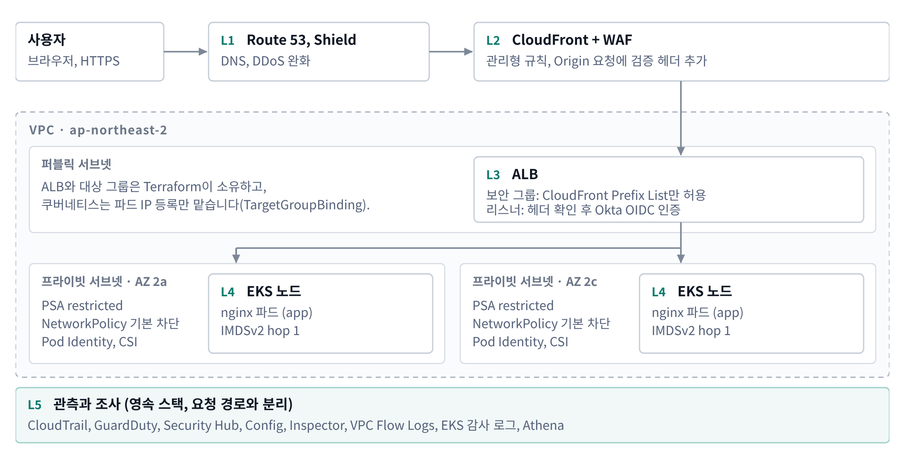

# Terraform으로 구성하는 클라우드 통합 보안 아키텍처

AWS에서 외부 경계(CloudFront, WAF, ALB 인증)부터 EKS 워크로드, CI/CD 권한, 감사 로그까지 Terraform으로 구성한 개인 프로젝트입니다. 통제를 하나 넣을 때마다 막혀야 할 요청이 실제로 막히는지, 허용한 경로는 그대로 동작하는지, 허용 범위가 의도한 만큼인지를 직접 시험해서 확인했습니다.

| | |
|---|---|
| 형태 | 개인 프로젝트(1인). 실사용 트래픽이 없는 검증 환경 |
| 기간 | 2026.03 ~ 2026.11 (저장소 기록 기준. Phase 1~3은 저장소를 만들기 전에 진행) |
| 환경 | AWS 단일 계정, 서울 리전(ap-northeast-2) |
| 주요 기술 | Terraform 1.14, EKS 1.35, GitHub Actions(OIDC), Okta OIDC, Checkov, Trivy, Syft |

## 아키텍처



외부 요청은 Route 53, CloudFront와 WAF, ALB를 차례로 지나 프라이빗 서브넷의 EKS 파드에 닿습니다. ALB 보안 그룹은 CloudFront 관리형 Prefix List에서 오는 연결만 받습니다. 리스너 규칙은 CloudFront가 붙인 `X-Origin-Verify` 헤더를 확인한 뒤 Okta OIDC 인증으로 넘깁니다.

워크로드는 EC2로 시작해 EKS로 옮겼습니다. 옮길 때 ALB와 대상 그룹은 Terraform이 계속 소유하게 두고, 쿠버네티스는 TargetGroupBinding으로 파드 IP만 등록하게 했습니다. EC2와 EKS 대상 그룹 사이의 트래픽 비율은 `ec2_traffic_weight`, `eks_traffic_weight` 변수로 조정합니다.

L5는 요청이 지나가는 계층이 아닙니다. 워크로드를 지워도 로그와 탐지가 이어지도록 별도 스택에 둔 관측 계층입니다.

## 저장소 구조

Terraform state를 리소스의 수명에 따라 6개 스택으로 나눴습니다. 영속 스택은 계속 유지하고, 세션 스택은 작업할 때 만들었다가 끝나면 지웁니다.

| 디렉터리 | 내용 |
|---|---|
| [`00-bootstrap`](00-bootstrap)<br>영속 | state 버킷(S3)과 잠금 테이블(DynamoDB), GitHub OIDC 공급자, CI 역할 4개. 이 스택만 로컬 state를 씁니다 |
| [`01-network`](01-network)<br>영속 | VPC(10.0.0.0/16), 퍼블릭과 프라이빗, 격리 서브넷(AZ 2개씩), 보안 그룹, ACM 인증서 2개(CloudFront용, ALB용) |
| [`02-security`](02-security)<br>영속 | CloudTrail, GuardDuty, Security Hub, Config, Inspector, VPC Flow Logs, 용도별 KMS 키, 로그 버킷, ECR, Athena, EKS 감사 로그 그룹, Okta 시크릿 보관 위치, 알림(EventBridge, SNS), 배포용 CodeBuild 러너 |
| [`03-workload`](03-workload)<br>세션 | CloudFront, WAF, ALB와 대상 그룹, NAT 게이트웨이, EC2, Route 53 레코드, Origin 검증 헤더 |
| [`04-eks`](04-eks)<br>세션 | EKS 클러스터와 노드 그룹, 애드온, Pod Identity 연결, LB Controller와 실습용 IAM, CI용 접근 항목 |
| [`05-k8s`](05-k8s)<br>세션 | app 네임스페이스와 nginx, NetworkPolicy, CI 배포용 RBAC, Secrets Store CSI, LB Controller(Helm) |
| [`images`](images) | `s5-good`(nginx 비루트 이미지), `s5-vuln`(Trivy 차단 확인용) |
| [`scripts`](scripts) | `session-ritual.ps1`(세션 시작 시 관리자 공인 IP를 `TF_VAR_my_ip`로 넣고 EKS 엔드포인트 허용 목록과 비교), `s5-build-push.ps1`(CI로 옮기기 전에 손으로 실행하던 빌드, 검사, 푸시 절차) |

스택 사이의 값은 SSM 파라미터로 넘깁니다. `terraform_remote_state`를 쓰지 않기 때문에 한 스택이나 CI가 다른 스택의 state 전체를 읽을 필요가 없습니다. 적용은 00부터 05까지 번호 순서대로 하고, 삭제는 05, 04, 03 순서로 합니다.

## 보안 통제 매핑

| 계층 | 막으려는 것 | 통제 | 코드 |
|---|---|---|---|
| L1 DNS | 대량 트래픽 | Route 53, Shield Standard | [`03-workload/route53.tf`](03-workload/route53.tf) |
| L2 엣지 | L7 공격, 봇, 과도한 요청 | WAF 관리형 규칙(IP 평판, SQLi, Common, Linux, Known Bad Inputs), IP별 요청 수 제한. 익명 IP 규칙은 Count로만 기록 | [`03-workload/waf.tf`](03-workload/waf.tf), [`cloudfront.tf`](03-workload/cloudfront.tf) |
| L3 출처와 인증 | ALB 직접 접근, 미인증 사용자 | 보안 그룹은 CloudFront Prefix List만 허용. 리스너에서 `X-Origin-Verify` 확인 뒤 Okta OIDC 인증. 헤더 값은 두 슬롯으로 두어 끊김 없이 교체 | [`01-network/security_groups.tf`](01-network/security_groups.tf), [`03-workload/alb.tf`](03-workload/alb.tf), [`origin_verify.tf`](03-workload/origin_verify.tf) |
| L4 노드 | SSRF로 노드 자격증명 탈취, 악성 AMI | IMDSv2 강제와 hop 제한 1. EC2 AMI는 소유자를 amazon으로 고정 | [`04-eks/eks.tf`](04-eks/eks.tf), [`03-workload/ec2.tf`](03-workload/ec2.tf) |
| L4 파드 실행 | 위험한 파드 설정 | app 네임스페이스에 PSA restricted(enforce, audit, warn). 비루트 실행, 권한 상승 금지, 읽기 전용 루트 | [`05-k8s/namespace.tf`](05-k8s/namespace.tf), [`workload.tf`](05-k8s/workload.tf) |
| L4 네트워크 | 내부 이동 | 네임스페이스마다 기본 차단. nginx는 ALB 서브넷에서 오는 8080만 받고 밖으로 나가는 연결은 없음. 실습 파드는 DNS와 443만 허용하고 IMDS 주소는 제외 | [`05-k8s/network-policy.tf`](05-k8s/network-policy.tf) |
| L4 자격증명 | 과도한 권한 | Pod Identity로 ServiceAccount마다 역할을 따로 줌. VPC CNI 권한은 노드 역할에서 분리 | [`04-eks/cni-identity.tf`](04-eks/cni-identity.tf), [`identity-demo-iam.tf`](04-eks/identity-demo-iam.tf) |
| L4 시크릿 | 시크릿 노출 | Secrets Store CSI로 파일만 주입하고 쿠버네티스 Secret은 만들지 않음. 원본은 Secrets Manager에만 둠 | [`05-k8s/secrets-csi.tf`](05-k8s/secrets-csi.tf), [`04-eks/secrets-demo-iam.tf`](04-eks/secrets-demo-iam.tf) |
| 키 관리 | 키 하나가 여러 데이터를 담당 | 로그, 시크릿, EBS, 이미지용 KMS 키를 따로 둠 | [`02-security/kms.tf`](02-security/kms.tf), [`ecr.tf`](02-security/ecr.tf) |
| L5 탐지 | 탐지 누락 | GuardDuty, Security Hub(CIS 1.4.0, FSBP), Config, Inspector(EC2, ECR). 심각도 기준으로 골라 SNS 메일 알림 | [`02-security/guardduty.tf`](02-security/guardduty.tf), [`securityhub.tf`](02-security/securityhub.tf), [`eventbridge.tf`](02-security/eventbridge.tf) |
| L5 증거 | 증거 소실과 변조 | CloudTrail(멀티 리전, 로그 파일 무결성 검증), Flow Logs(S3, Parquet), EKS 감사 로그(영속 스택, 14일 보존), Athena 테이블과 저장 쿼리 | [`02-security/cloudtrail.tf`](02-security/cloudtrail.tf), [`vpc_flow_logs.tf`](02-security/vpc_flow_logs.tf), [`eks_control_plane_logs.tf`](02-security/eks_control_plane_logs.tf), [`athena.tf`](02-security/athena.tf) |
| 공급망 | 변조된 액션, 취약한 이미지 | 워크플로의 액션은 모두 커밋 SHA로 고정. Trivy 검사, ECR 불변 태그, 베이스 이미지 digest 고정, Dependabot, gitleaks 훅 | [`.github/workflows`](.github/workflows), [`images/s5-good/Dockerfile`](images/s5-good/Dockerfile), [`.pre-commit-config.yaml`](.pre-commit-config.yaml) |

## CI/CD와 신원 모델

GitHub Actions는 장기 액세스 키 없이 OIDC로 역할을 받습니다. 역할마다 수임 조건과 닿을 수 있는 범위를 다르게 두었습니다.

| 역할 | 수임 조건 | 하는 일 | 할 수 없는 일 |
|---|---|---|---|
| plan | `pull_request`에서만 | 01, 02 스택 plan | 03, 05 state 읽기, Okta 시크릿 조회, KMS 복호화, 감사 로그 열람과 쿼리 실행, 헤더 값이 담긴 설정 조회, 잠금 테이블 쓰기 |
| build | `main` 브랜치에서만 | 앱 ECR 리포지토리에 이미지 푸시, SBOM 생성 | 이미지 삭제, 클러스터 접근 |
| deploy | `main` 브랜치에서만 | VPC 안의 CodeBuild 러너에서 app 네임스페이스 nginx Deployment의 이미지 변경 | Secret 읽기, exec, 다른 객체 변경 |
| sign | `main` 브랜치에서만 | 이미지 서명용 KMS 키 사용. 현재 워크플로에서는 쓰지 않음 | |

| 워크플로 | 실행 시점 | 내용 |
|---|---|---|
| [`terraform-plan.yml`](.github/workflows/terraform-plan.yml) | main 대상 PR | 01, 02 스택 plan. 같은 실행에서 plan 역할의 경계를 점검하고(허용 3, 거부 12) 결과를 PR 코멘트로 남김 |
| [`checkov.yml`](.github/workflows/checkov.yml) | IaC나 워크플로가 바뀐 PR | Terraform과 GitHub Actions 설정 정적 검사. 위반이 있으면 job 실패 |
| [`build-deploy.yml`](.github/workflows/build-deploy.yml) | `images/`나 이 워크플로 파일이 바뀐 main 푸시, 수동 실행 | build: 같은 태그 이미지가 없을 때만 빌드, Trivy 검사(수정본이 있는 HIGH 이상이면 중단), 푸시, Syft로 CycloneDX SBOM 생성. deploy: `DEPLOY_ENABLED`가 true일 때만 실행. 배포 전 RBAC 점검(허용 1, 거부 5), 롤아웃, 배포된 이미지 확인 |
| [`dependabot.yml`](.github/dependabot.yml) | 매주 | GitHub Actions, Terraform provider, 베이스 이미지 갱신 PR |

## 검증 방식과 결과

성공한 결과만 보면 권한이 넓어서 된 것인지, 정확하게 설정해서 된 것인지 구분할 수 없습니다. 그래서 통제마다 세 가지를 같이 확인했습니다.

1. 막혀야 할 요청이 실제로 막히는가
2. 허용한 경로는 그대로 동작하는가
3. 허용 범위가 의도한 만큼인가

| 시험 | 결과 | 확인하지 못한 부분 |
|---|---|---|
| plan 역할 경계 | 허용 3개 성공, 거부 12개 모두 거부. 01, 02 plan은 No changes | |
| CI 신원으로 `hostNetwork: true` 주입 | 변경 요청은 200으로 통과, 파드 생성은 403(컨트롤러 재시도 14회). 생성된 파드 0개, 기존 파드 2개 유지 | |
| CI 신원으로 다른 ServiceAccount 지정 | 파드 생성 403(재시도 9회). 해당 SA가 다른 네임스페이스에만 있어 참조 불가 | command, 환경 변수처럼 PSA가 보지 않는 필드는 여전히 바꿀 수 있음 |
| deploy 역할 RBAC | nginx 패치 1건 허용, Secret 읽기와 exec 등 5건 거부 | |
| Pod Identity | 연결된 파드는 지정한 S3 객체 읽기 성공, 버킷 목록 조회는 AccessDenied. 연결 없는 파드는 NoCredentials | |
| NetworkPolicy | 다른 노드에 있는 파드 사이의 통신 차단 | |
| Secrets Store CSI | 쿠버네티스 Secret 객체 0개. 허용되지 않은 파드는 자격증명을 받지 못함 | |
| Trivy | OpenSSL HIGH 취약점이 있는 빌드를 중단. 베이스 이미지 갱신 후 통과 | 이미지를 재사용하는 실행은 검사를 건너뜀 |
| Origin 헤더 교체 | 2초 간격 프로브 656건이 모두 302, 403은 0건. 이전 값을 함께 허용한 시간 19분 50초 | 측정 지점 한 곳, 인증 전 요청만 확인 |
| 노드 drain | PDB가 두 파드의 동시 퇴거를 막고, 대체 파드가 준비된 뒤 drain 완료 | 갑작스러운 노드 장애는 확인하지 않음 |
| 감사 로그 보존 | 클러스터 삭제 후에도 로그 스트림 8개가 남아 있고, 삭제 전 이벤트를 다시 조회 | |
| CloudTrail 무결성 | 조사 구간의 digest 7개, 로그 파일 100개가 모두 유효 | EKS 감사 로그와 Flow Logs에는 같은 검증이 없음 |

모든 수치는 개인 검증 환경에서 작업 세션마다 직접 실행해서 얻은 값입니다.

## 진행 이력

먼저 끝까지 동작하는 최소 구성을 만들고, 보안 계층을 하나씩 더했습니다.

| 단계 | 내용 |
|---|---|
| Phase 1 기반 | VPC 3계층 서브넷, 보안 그룹 체인, EC2, ALB |
| Phase 2 엣지 | CloudFront와 WAF, Prefix List와 Origin 헤더로 ALB 직접 접근 차단 |
| Phase 3 인증 | Route 53, ACM, ALB에서 Okta OIDC 인증 |
| Phase 4 관측 | CloudTrail, GuardDuty, Security Hub, Config, Inspector, Flow Logs. 스택을 나누고 SSM으로 연결 |
| Phase 5 키 관리와 CI | 용도별 KMS 키, Secrets Manager, GitHub OIDC plan CI, Checkov, Dependabot, gitleaks |
| Phase 6 S1~S2 | 기존 경계를 유지한 채 EKS로 전환(TargetGroupBinding), Pod Identity |
| Phase 6 S3~S4 | VPC CNI NetworkPolicy, Secrets Store CSI |
| Phase 6 S5~S6 | ECR, Trivy, Inspector. OIDC 빌드와 VPC 내부 러너 배포 |
| v1 보강 | plan 역할 축소, EKS 감사 로그, Athena 조사 계층, app 네임스페이스와 PSA, 가용성 설정, Checkov 실패 58건 정리, Origin 헤더 무중단 교체 |

## 설계 결정

| 결정 | 고른 것 | 고르지 않은 것 | 이유 |
|---|---|---|---|
| 스택 분리 | 수명 기준 6개 스택 | 스택 하나 | 탐지 서비스와 키, 로그는 계속 두고 비용이 큰 리소스만 세션마다 만들고 지움. KMS 키가 워크로드와 함께 지워지면 그 키로 암호화한 로그를 읽을 수 없게 되는 문제도 피함 |
| 스택 간 값 전달 | SSM 파라미터 | `terraform_remote_state` | 상대 스택의 state 전체를 읽을 권한이 필요 없음. 03 state에는 Okta 시크릿과 헤더 값이 들어 있음 |
| EKS 진입 경로 | TargetGroupBinding | LB Controller가 ALB를 새로 만드는 방식 | 기존 ALB의 보안 그룹, 헤더 규칙, OIDC 설정을 그대로 유지하고 소유권 충돌을 줄임 |
| 시크릿 전달 | Secrets Store CSI 파일 마운트 | External Secrets Operator | ESO는 쿠버네티스 Secret에 사본이 생겨 노출 지점이 늘어남 |
| 네트워크 정책 | VPC CNI NetworkPolicy | Calico | 필요한 것은 네임스페이스 단위 차단과 허용이어서 EKS 애드온으로 충분함 |
| EKS 스택 분할 | AWS 리소스(04)와 쿠버네티스 리소스(05) 분리 | 한 스택에서 관리 | 쿠버네티스 provider가 plan 단계에서 클러스터 엔드포인트를 요구해 생성과 삭제가 실패했음 |
| 로그 저장소 | S3 기본, EKS 감사 로그만 CloudWatch | 모두 CloudWatch | 비용 때문에 S3를 기본으로 함. EKS 컨트롤 플레인 로그는 CloudWatch로만 나오므로 예외로 두고 로그 그룹은 영속 스택에 만듦 |
| CI 배포 권한 | nginx Deployment patch만 부여 | CI가 05 스택 전체를 apply | 배포에 필요한 권한만 줌. patch는 필드를 가리지 않아 PSA로 보완함 |
| plan 역할 신뢰 조건 | `pull_request`만 허용 | main 브랜치도 허용 | plan 워크플로는 PR에서만 돌기 때문에 쓰지 않는 신뢰 경로를 없앰 |

## 한계와 다음 단계

남은 위험과 완료 기준입니다.

| 항목 | 지금 상태 | 완료 기준 |
|---|---|---|
| CI의 클러스터 변경 권한 | CI가 가진 Deployment patch 권한으로 command, 환경 변수 같은 필드도 바꿀 수 있음 | ArgoCD로 전환해 deploy 역할의 EKS 접근 항목과 RBAC를 지움. 클러스터 변경은 Git에 머지된 내용을 동기화할 때만 일어남 |
| EKS 감사 로그 탐지 | GuardDuty의 EKS 감사 로그 모니터링이 꺼져 있음 | 기능이 활성 상태이고 plan에 변경이 없음 |
| 배포 시점 취약점 확인 | 이미지를 재사용하는 실행은 검사를 건너뜀 | 이미지 digest를 바꾸는 PR에서 Inspector 결과를 확인하고, 기준을 넘으면 머지가 막힘. 이미 고정된 digest도 정기 점검에서 기준을 넘으면 알림이 옴 |
| LB Controller 권한 | `ec2:DescribeInternetGateways` 읽기 권한이 빠져 거부 기록이 남음 | CloudTrail에 거부 기록이 없음 |

확인하지 못한 것도 있습니다. WAF Count 규칙이 실제로 매칭되는지는 보지 못했고, DNS 로그가 없어서 외부 통신 조사는 Flow Logs 상위 행까지만 했습니다.

- ArgoCD를 쓰는 GitOps 배포. CI는 이미지 빌드와 매니페스트의 digest 갱신까지만 맡음
- AWS Organizations와 SCP를 쓰는 멀티 계정 구성
- 이미지 서명과 admission 단계의 서명 검증
- 공유 비밀 값인 헤더 대신 CloudFront VPC Origins로 Origin 보호
- EKS API 엔드포인트 비공개 전환(지금은 퍼블릭 엔드포인트를 관리자 IP로 제한)

## 재현 방법

> 세션 스택(03~05)에는 NAT 게이트웨이, ALB, EKS처럼 시간당 비용이 나오는 리소스가 있습니다. 작업이 끝나면 바로 지우는 것을 전제로 합니다.

준비할 것

- AWS 계정과 관리자 자격증명(IAM Identity Center 프로필)
- Route 53에 호스팅 영역이 있는 도메인. ACM 검증과 레코드 생성에서 이 영역을 조회합니다
- Okta OIDC 애플리케이션
- Terraform 1.14.x, AWS CLI v2, kubectl, PowerShell(스크립트용)

적용 순서

1. `00-bootstrap`을 로컬 state로 적용합니다. 출력되는 state 버킷과 잠금 테이블 이름을 나머지 스택의 `backend.tf`에 맞춥니다.
2. `01-network`를 적용합니다. `domain_name`을 넣어야 합니다.
3. `02-security`를 적용하고 `alert_email`을 알림 받을 주소로 바꿉니다. 그다음 Okta 값을 Secrets Manager에 넣습니다. Okta 값은 Terraform 코드나 tfvars에 넣지 않습니다.

   ```bash
   aws secretsmanager put-secret-value \
     --secret-id devsecops-project/okta/oidc \
     --secret-string '{"issuer_url":"https://<okta-domain>/oauth2/default","client_id":"<client-id>","client_secret":"<client-secret>"}'
   ```

4. `03-workload`를 적용합니다. `domain_name`을 넣어야 합니다.
5. `scripts/session-ritual.ps1`로 관리자 공인 IP를 `TF_VAR_my_ip`에 넣은 뒤 `04-eks`를 적용합니다.
6. `images/s5-good` 이미지를 ECR에 올립니다. GitHub Actions의 build job이나 `scripts/s5-build-push.ps1`을 쓰면 됩니다.
7. `05-k8s`의 `app_image_tag`, `app_image_digest`를 올린 이미지 값으로 맞추고 적용합니다.

GitHub 저장소 설정

워크플로는 Repository variables에서 아래 값을 읽습니다. 시크릿은 쓰지 않습니다.

| 변수 | 값 |
|---|---|
| `AWS_ROLE_ARN` | plan 역할 ARN |
| `AWS_BUILD_ROLE_ARN` | build 역할 ARN |
| `AWS_DEPLOY_ROLE_ARN` | deploy 역할 ARN |
| `CODEBUILD_RUNNER` | 02-security가 만든 CodeBuild 프로젝트 이름 |
| `DOMAIN_NAME` | 도메인 |
| `DEPLOY_ENABLED` | 클러스터가 떠 있을 때만 `true` |

정리

`05-k8s`, `04-eks`, `03-workload` 순서로 destroy 합니다. 00~02는 지우지 않습니다. 02를 지우면 KMS 키가 삭제 대기에 들어가고, 그 키로 암호화한 로그를 더 이상 읽을 수 없게 됩니다.
